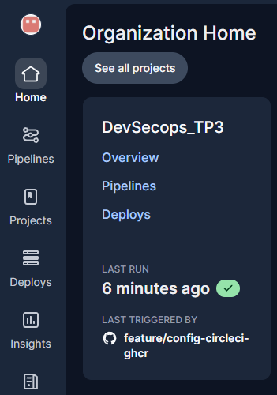
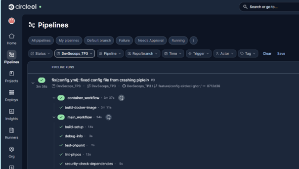
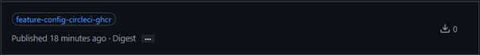
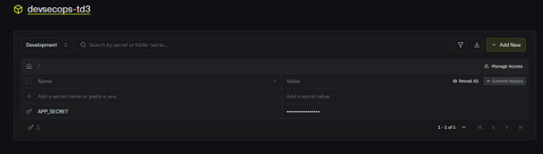
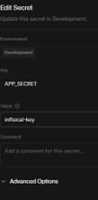
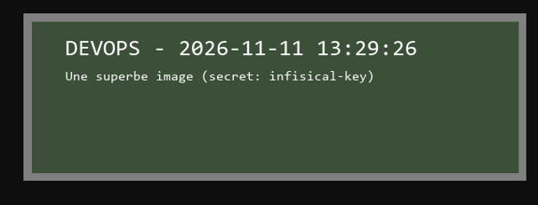

# Partie 2 – Pipeline CI/CD (GitHub, CircleCI, GHCR) et secrets (Infisical)

Objectifs de cette partie (d'après le sujet du TP) :

1. **GitHub et CircleCI** : créer le projet sur GitHub et configurer CircleCI.
2. **Pipeline CI/CD** : comprendre et configurer les jobs CircleCI existants (intégration continue, construction de l'image Docker, stockage sur GHCR) et renseigner les variables nécessaires dans CircleCI.
3. **Secrets avec Infisical** : gérer les secrets de l'application de manière sécurisée.

> Les captures d'écran sont dans `screenshots/`. Les valeurs secrètes sont toujours masquées.

---

## 1. GitHub et CircleCI

### 1.1 Projet CircleCI

Connexion avec GitHub, organisation = le compte propriétaire du fork, puis *Projects → Set Up Project* sur le dépôt, en utilisant le fichier `.circleci/config.yml` existant.



### 1.3 Variables

Renseignées dans *Project Settings → Environment Variables* :

| Variable | Utilisée par | Valeur |
|---|---|---|
| `GHCR_USERNAME` | `build-docker-image` (docker login) | Identifiant GitHub du propriétaire du fork |
| `GHCR_PAT` | `build-docker-image` (docker login) | Token GitHub **classic** avec uniquement le scope `write:packages` |

Pourquoi un token **classic** : GHCR n'accepte pas les tokens fine-grained pour pousser des images de conteneur. Nous lui avons donné le scope minimal et une expiration courte.

---

## 2. Le pipeline

### 2.1 Fonctionnement

Deux workflows sont définis dans `.circleci/config.yml` :

```
main_workflow
  build-setup ──┬── lint-phpcs
                ├── security-check-dependencies
                └── test-phpunit
  hold (approbation manuelle, main / release/*) ──▶ deploy-ssh-staging (release/*)
  (deploy-ssh-production : désactivé, écrit en partie 3)

container_workflow
  build-docker-image ──▶ ghcr.io/<propriétaire>/<repo>:<branche>
```

| Job | Rôle |
|---|---|
| `build-setup` | `composer install`, cache de `vendor/`, partagé avec les autres jobs via le workspace CircleCI. |
| `lint-phpcs` | PHP_CodeSniffer (PSR-12 + PHPCompatibility). Rapport sauvegardé en artefact. |
| `security-check-dependencies` | `local-php-security-checker` sur `composer.lock`. Rapport sauvegardé en artefact. |
| `test-phpunit` | Lance la suite de tests `Unit`. |
| `build-docker-image` | Construit l'image avec `Docker/Dockerfile` et la pousse sur GHCR. |

### 2.2 Problèmes rencontrés et corrections

| # | Problème | Symptôme | Correction |
|---|---|---|---|
| A1 | Les executors utilisaient PHP 8.1, alors que le projet exige PHP >= 8.2. | `composer install` refuse de s'exécuter. | `cimg/php:8.1` → `cimg/php:8.2` (et `8.2-node`). |
| A2 | `deploy-ssh-production` est utilisé dans le workflow mais n'est pas défini. | CircleCI rejette toute la configuration. | Mis en commentaire dans le workflow, à écrire en partie 3. |
| P1 | `test-phpunit` exécutait `composer require --dev phpunit/phpunit` sans version. | Voir ci-dessous. | Étape supprimée : PHPUnit est déjà installé par `build-setup`. |
| P2 | `setup_remote_docker` demandait Docker `20.10.23` et `docker_layer_caching`. | Voir ci-dessous. | `version: default`, sans cache de couches. |

Docker 20.10.23 est trop ancien pour CircleCI et `docker_layer_caching` est une option payante. Sans le cache de couches, les builds sont seulement un peu plus lents.

### 2.3 Résultat

Tous les jobs sont verts après le push.



---

## 3. Image sur GHCR

Notre branche `feature/config-circleci-ghcr` donne :

```
ghcr.io/<propriétaire>/devsecopstp3:feature-config-circleci-ghcr
```

L'image est visible dans l'onglet *Packages* du profil GitHub.



Si le package est privé, il faut d'abord se connecter avec le token :

```bash
echo <token> | docker login ghcr.io -u <propriétaire> --password-stdin
docker run --rm -p 8080:80 -e APP_SECRET=demo ghcr.io/<propriétaire>/devsecopstp3:feature-config-circleci-ghcr
```

---

## 4. Secrets avec Infisical

### 4.1 Principe

Le secret `APP_SECRET` ne doit être écrit ni dans le code, ni dans l'image, ni dans un fichier commité. Il est stocké dans Infisical. Au démarrage, le conteneur se connecte à Infisical avec une **machine identity** et reçoit le secret sous forme de variable d'environnement.

```
docker run (client id / client secret / project id)
        │
        ▼
docker-entrypoint.sh ── infisical login (Universal Auth) ──▶ Infisical
        │                                                        │
        ▼                                                        │
infisical run ── récupère les secrets ◀──────────────────────────┘
        │
        ▼
apache2-foreground  (APP_SECRET est dans l'environnement, affiché sur l'image)
```

### 4.2 Configuration dans Infisical

1. Nouveau **projet** (`devsecops-tp3`, type Secrets Management) avec le secret `APP_SECRET` dans l'environnement `dev`.
2. Nouvelle **machine identity** avec **Universal Auth**. Son rôle au niveau de l'organisation est le minimum possible.
3. Identité **ajoutée au projet** avec un rôle en lecture seule (**Viewer**).
4. Un **Client Secret** créé pour l'identité.




### 4.3 Modifications dans le dépôt

| Fichier | Modification |
|---|---|
| `docker-entrypoint.sh` | Si `INFISICAL_CLIENT_ID`, `INFISICAL_CLIENT_SECRET` et `INFISICAL_PROJECT_ID` sont définis : connexion, puis `exec infisical run -- "$@"`. Sinon, démarrage normal. |
| `Docker/Dockerfile` | Copie le script dans `/usr/local/bin` (hors de la racine web), `ENTRYPOINT` + `CMD ["apache2-foreground"]`. |
| `.gitignore` | Ajout de `.env.infisical`. |
| `.env.example` | Liste les noms des variables Infisical, sans valeurs. |

Détails utiles :

- Définir un `ENTRYPOINT` réinitialise le `CMD` de l'image de base, d'où le `CMD ["apache2-foreground"]` écrit à nouveau.
- Le script est à la racine du dépôt, car `.dockerignore` exclut le dossier `Docker/` du contexte de build.
- Après la connexion, le client id et le client secret sont supprimés de l'environnement (`unset`) : Apache/PHP ne les reçoit pas.
- Sans identifiants, le conteneur démarre comme avant : le `docker compose up` de la partie 1 fonctionne toujours.

### 4.4 Fichier d'identifiants local

Les identifiants sont dans `.env.infisical` (ignoré par git). Son nom commence par `.env` volontairement : `.dockerignore` exclut déjà `.env*`, donc le fichier ne peut **pas** se retrouver dans l'image. Un nom comme `infisical.env` aurait été copié par `COPY . /var/www/html`.

```
INFISICAL_CLIENT_ID=...
INFISICAL_CLIENT_SECRET=...
INFISICAL_PROJECT_ID=...
INFISICAL_ENV=dev
```

### 4.5 Test

```bash
docker build -f Docker/Dockerfile -t devsecops-tp3:local .
# sans Infisical (comme en partie 1)
docker run --rm -p 8080:80 -e APP_SECRET=demo-secret devsecops-tp3:local
# avec Infisical
docker run --rm -p 8080:80 --env-file .env.infisical devsecops-tp3:local
```

Logs avec Infisical : `[entrypoint] Fetching secrets from Infisical (env: dev)`, et l'image affiche la valeur stockée dans Infisical.



---

## 5. Bilan de la partie 2

- Projet CircleCI configuré avec `GHCR_USERNAME` et `GHCR_PAT` (token classic, `write:packages` uniquement).
- Le pipeline est vert : PHP 8.2, chemin `Docker/` correct, job de déploiement en production désactivé jusqu'à la partie 3.
- L'image est publiée sur GHCR, taguée avec le nom de la branche.
- `APP_SECRET` vient d'Infisical via une machine identity en lecture seule ; aucun secret n'est dans le dépôt ni dans l'image.

### Points restants (pour les parties suivantes)

- `deploy-ssh-production` reste à écrire (partie 3).
- `lint-phpcs` transforme toujours les erreurs de style en succès (A3), les tests sont toujours des placeholders (A5) et `phpcs.xml` cible toujours PHP 7.4+ (A6).
- La source de couverture de `phpunit.xml` pointe toujours vers `./app` au lieu de `./src` (A4).
- `public/info.php` expose toujours l'environnement, y compris `APP_SECRET` (A7) : il doit être retiré de l'image (partie 5).
- Le client secret Infisical et le token GitHub sont des valeurs à longue durée de vie : les renouveler et utiliser des expirations courtes (partie 5).

### Fichiers modifiés dans cette partie

| Fichier | Modification |
|---|---|
| `.circleci/config.yml` | PHP 8.2, chemin `Docker/Dockerfile`, étape PHPUnit supprimée, `setup_remote_docker` corrigé, déploiement en production commenté. |
| `docker-entrypoint.sh` | Nouveau. Récupère les secrets d'Infisical au démarrage. |
| `Docker/Dockerfile` | `ENTRYPOINT` / `CMD` pour le script de démarrage. |
| `.gitattributes` | Nouveau. Fins de ligne LF pour les scripts shell. |
| `.gitignore`, `.env.example` | `.env.infisical` ignoré ; noms des variables Infisical documentés. |
| `doc/` | Cette documentation + captures d'écran. |
