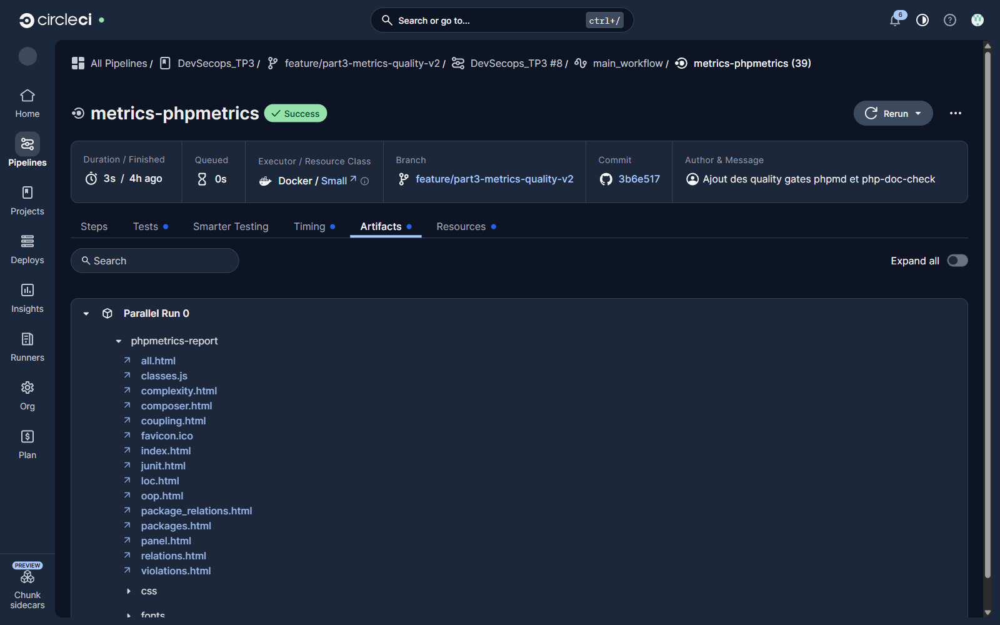
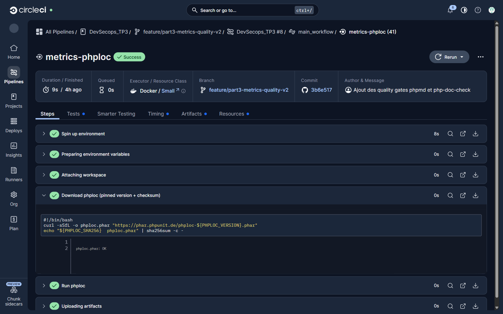
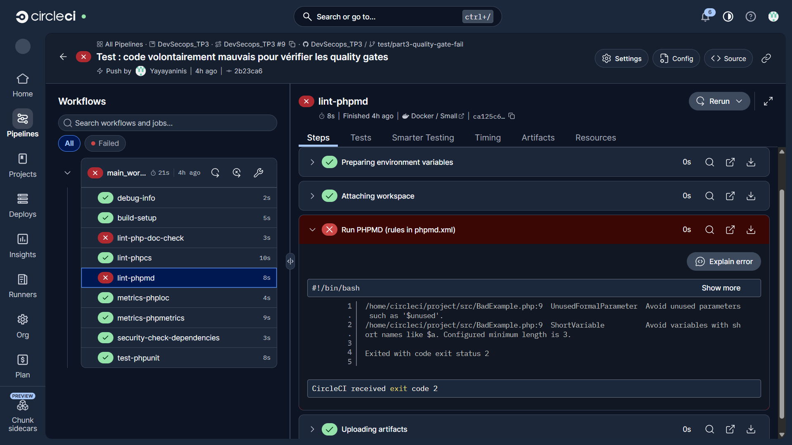
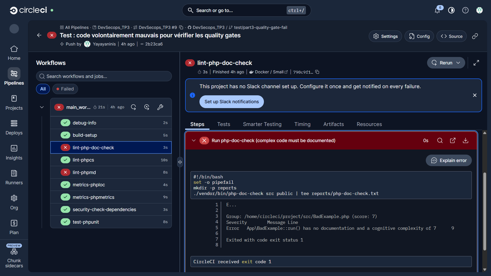
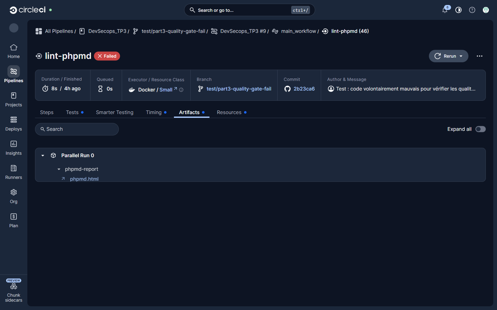

# Partie 3 (points 1 et 2) – Métriques et qualité du code dans le pipeline

Objectifs de cette partie (d'après le sujet du TP) :

1. **Évaluation du code** : ajouter deux jobs d'évaluation automatique du code, avec phpmetrics et phploc.
2. **Qualité du code** : intégrer des outils de vérification de la qualité, avec phpmd et php-doc-check.

> Le travail est sur la branche `feature/part3-metrics-quality-v2`. Les captures d'écran sont dans `screenshots/`.

Nous avons seulement **ajouté** des jobs au fichier `.circleci/config.yml`, sans modifier les jobs existants. Chaque commande a d'abord été testée en local avant d'être mise dans la CI.

---

## 1. Vue d'ensemble

| Job | Outil | Rôle | Bloque le pipeline ? |
|---|---|---|---|
| `metrics-phpmetrics` | PhpMetrics | Métriques | Non |
| `metrics-phploc` | phploc | Métriques | Non |
| `lint-phpmd` | PHPMD | Qualité | Oui |
| `lint-php-doc-check` | php-doc-check | Qualité | Oui |

Les noms suivent la convention proposée en haut du fichier de configuration : `metrics-` pour les métriques et `lint-` pour la qualité du code.

Les quatre jobs attendent seulement `build-setup`, qui installe les dépendances. Ils récupèrent ensuite le projet avec `attach_workspace` et tournent en parallèle des jobs déjà présents.


Nous avons fait une différence entre deux types de jobs :

- **Les jobs de métriques** mesurent le code : nombre de lignes, complexité, etc. Ces chiffres ne sont ni bons ni mauvais en soi, donc ces jobs ne bloquent rien. Ils gardent juste leur rapport dans l'onglet *Artifacts* de CircleCI.
- **Les jobs de qualité** vérifient des règles. Si le code ne les respecte pas, l'outil renvoie une erreur et le job échoue, ce qui bloque le pipeline.

---

## 2. Installation des outils

Plutôt que d'installer les outils dans chaque job avec `composer require`, nous les avons ajoutés une seule fois dans les dépendances de développement du projet :

```bash
composer require --dev phpmetrics/phpmetrics phpmd/phpmd niels-de-blaauw/php-doc-check
```

Ainsi, les versions sont fixées dans `composer.lock`. La CI utilise donc exactement les versions testées en local, et un outil ne peut pas changer de version sans que nous le décidions. C'est plus sûr : une nouvelle version d'un paquet pourrait contenir un bug ou du code malveillant. Les outils sont aussi installés une seule fois, dans `build-setup`, au lieu d'une fois par job.

Notre PC a une version de PHP plus récente que celle de la CI et de Docker, qui utilisent PHP 8.2. Nous avons donc indiqué à Composer de choisir des versions compatibles avec PHP 8.2 :

```bash
composer config platform.php 8.2.0
```

Sans ce réglage, Composer installait des paquets qui fonctionnaient chez nous mais pas dans la CI.

L'image Docker n'est pas concernée, car elle installe uniquement les dépendances de production.

Enfin, le dossier `reports/`, où les outils écrivent leurs rapports, est ajouté au `.gitignore` : ce sont des fichiers générés, il n'y a pas de raison de les versionner.

---

## 3. Les jobs de métriques

### 3.1 PhpMetrics

```yaml
  metrics-phpmetrics:
    executor: php-executor
    steps:
      - *attach_workspace
      - run:
          name: Generate PhpMetrics report
          command: ./vendor/bin/phpmetrics --report-html=reports/phpmetrics src
      - store_artifacts:
          path: reports/phpmetrics
          destination: phpmetrics-report
```

PhpMetrics produit un rapport HTML. Sur notre projet, il trouve une classe de 43 lignes, une complexité faible et aucun problème.


Le rapport est conservé avec le build, dans l'onglet *Artifacts* :



### 3.2 phploc

phploc n'est plus maintenu, et sa version Composer n'est pas compatible avec la version de PHPUnit du projet. Nous utilisons donc le fichier PHAR officiel, c'est-à-dire l'outil complet dans un seul fichier téléchargeable.

Comme on télécharge un programme depuis Internet, nous avons pris deux précautions :

- nous téléchargeons une version précise, la 7.0.2, et pas « la dernière » ;
- nous vérifions l'empreinte SHA-256 du fichier avant de l'exécuter. Si le fichier a été modifié sur le serveur, la vérification échoue et le job s'arrête avant de le lancer.

```yaml
  metrics-phploc:
    executor: php-executor
    environment:
      PHPLOC_VERSION: 7.0.2
      PHPLOC_SHA256: 3d59778ec86faf25fd00e3a329b2f9ad4a3c751ca91601ea7dab70f887b0bf46
    steps:
      - *attach_workspace
      - run:
          name: Download phploc (pinned version + checksum)
          command: |
            curl -sSfL -o phploc.phar "https://phar.phpunit.de/phploc-${PHPLOC_VERSION}.phar"
            echo "${PHPLOC_SHA256}  phploc.phar" | sha256sum -c -
      - run:
          name: Run phploc
          command: |
            set -o pipefail
            mkdir -p reports
            php phploc.phar src public | tee reports/phploc.txt
      - store_artifacts:
          path: reports/phploc.txt
          destination: phploc-report/phploc.txt
```

Dans la CI, on voit bien la vérification passer avant que phploc soit lancé :



`tee` affiche le résultat dans le log de CircleCI et l'écrit aussi dans un fichier, qu'on garde comme artefact. La ligne `set -o pipefail` est expliquée plus bas, en 4.2.


---

## 4. Les jobs de qualité

### 4.1 PHPMD

Au premier lancement, PHPMD a trouvé trois remarques dans `src/ImageCreator.php` :

- la variable `$im` a un nom trop court ;
- le code lit deux fois la variable `$_ENV`.

Nous n'avons pas voulu modifier le code de l'application, et ces deux cas sont normaux ici. Nous avons donc écrit nos règles dans un fichier `phpmd.xml`, comme le projet le fait déjà pour `phpcs.xml`, avec deux exceptions commentées :

- l'accès à `$_ENV` est autorisé, parce que c'est là que la bibliothèque `phpdotenv` range les variables du fichier `.env` ;
- `$im` est autorisé, parce que c'est le nom habituel d'une image dans la documentation PHP. Les autres noms trop courts restent interdits.

```yaml
  lint-phpmd:
    executor: php-executor
    steps:
      - *attach_workspace
      - run:
          name: Run PHPMD (rules in phpmd.xml)
          command: |
            mkdir -p reports
            ./vendor/bin/phpmd analyze src public \
              --ruleset phpmd.xml \
              --format text \
              --reportfile-html reports/phpmd.html \
              --no-progress
      - store_artifacts:
          path: reports/phpmd.html
          destination: phpmd-report/phpmd.html
```

Les problèmes trouvés s'affichent dans le log, et un rapport HTML est gardé comme artefact. Si PHPMD trouve un problème, il renvoie une erreur et le job échoue.


### 4.2 php-doc-check

Cet outil vérifie que les fonctions compliquées ont un commentaire de documentation. Si une fonction est trop complexe et n'est pas documentée, il renvoie une erreur. Notre projet passe sans remarque.

```yaml
  lint-php-doc-check:
    executor: php-executor
    steps:
      - *attach_workspace
      - run:
          name: Run php-doc-check (complex code must be documented)
          command: |
            set -o pipefail
            mkdir -p reports
            ./vendor/bin/php-doc-check src public | tee reports/php-doc-check.txt
      - store_artifacts:
          path: reports/php-doc-check.txt
          destination: php-doc-check-report/php-doc-check.txt
```

Nous sommes tombés sur un piège avec `tee`. Quand on enchaîne deux commandes avec `|`, bash ne garde que le résultat de la dernière, ici `tee`, qui réussit toujours. L'erreur de php-doc-check était donc perdue et le job restait vert. La ligne `set -o pipefail` corrige ça : le job échoue si l'une des commandes échoue. Nous l'avons mise aussi dans le job phploc, qui utilise `tee` de la même façon.

---

## 5. Vérification : les jobs de qualité bloquent bien

Un job de qualité qui ne passe jamais au rouge ne prouve rien. Pour le vérifier, nous avons poussé une branche de test, `test/part3-quality-gate-fail`, avec un fichier volontairement mal écrit : un paramètre inutilisé, une variable `$a` et une fonction compliquée sans documentation. Cette branche n'est pas destinée à être fusionnée.


Résultat : `lint-phpmd` et `lint-php-doc-check` échouent, donc le pipeline échoue. Les jobs de métriques restent verts, ce qui est normal puisqu'ils ne bloquent pas.

PHPMD signale le paramètre inutilisé et la variable `$a`. On voit donc que l'exception pour `$im` ne laisse pas passer les autres noms courts :



php-doc-check signale la fonction non documentée. Grâce à `pipefail`, l'erreur arrive bien jusqu'à CircleCI :



Même quand le job échoue, le rapport reste disponible dans les artefacts, ce qui permet de voir ce qui ne va pas :




Nous avons aussi vérifié que nos ajouts ne cassent rien : le test PHPUnit passe toujours, l'application fonctionne dans Docker et l'image Docker se construit toujours dans la CI.

---

## 6. Remarque pour la suite

Sur la branche de test, le job existant `lint-phpcs` est resté vert malgré le mauvais code. Son script transforme les erreurs en succès, donc il ne bloque jamais rien. C'est un point à reprendre dans la partie 5 sur la sécurité.

---

## 3.3. Déploiement sur AWS

Le déploiement AWS est réalisé par le workflow GitHub Actions
`.github/workflows/aws.yml`, déclenché lorsqu'un commit est poussé sur la branche
`main`. Le workflow construit l'image Docker, la publie dans Amazon ECR, puis
met à jour le service Amazon ECS avec cette nouvelle image.

### 3.3.1. La définition de tâche ECS

Le fichier [`aws/task_definition.json`](../aws/task_definition.json) est
nécessaire au déploiement. Il décrit la manière dont ECS doit lancer le
conteneur : nom du conteneur, image Docker, mémoire, port 80, mode réseau
`awsvpc`, rôle d'exécution IAM et compatibilité avec EC2.

Le workflow utilise l'action
`amazon-ecs-render-task-definition` pour remplacer l'image indiquée dans cette
définition par l'image nouvellement construite et identifiée par le SHA du
commit. La définition rendue est ensuite envoyée à ECS par
`amazon-ecs-deploy-task-definition`. Il est donc important de versionner ce
fichier et de le maintenir en cohérence avec le nom réel du conteneur (`Main`).

### 3.3.2. Variables et secrets du déploiement

Les paramètres du déploiement sont stockés dans GitHub, dans l'environnement
`production` du dépôt (**Settings > Environments > production**), et ne sont
pas écrits en dur dans le workflow :

| Type GitHub | Variables |
|---|---|
| **Variables** (`vars`) | `AWS_REGION`, `ECR_REPOSITORY`, `ECS_SERVICE`, `ECS_CLUSTER`, `ECS_TASK_DEFINITION`, `CONTAINER_NAME` |
| **Secrets** (`secrets`) | `AWS_ACCESS_KEY_ID`, `AWS_SECRET_ACCESS_KEY` |

Les variables non sensibles servent à identifier les ressources AWS. Les clés
d'accès sont des secrets GitHub et ne doivent jamais être commitées dans le
dépôt, affichées dans les logs ou placées dans `task_definition.json`. Le rôle
IAM utilisé par ces clés doit être limité aux permissions nécessaires pour
construire/publier l'image ECR et déployer la tâche ECS.

### 3.3.3. Ressources AWS à gérer

Un déploiement ECS ne consiste pas uniquement à pousser une image. Les
ressources suivantes doivent être créées, configurées et surveillées :

1. **L'instance EC2 (ou la capacité ECS)** : comme la définition actuelle
   demande la compatibilité `EC2`, une instance enregistrée dans le cluster,
   avec l'agent ECS et un rôle IAM adaptés, doit être disponible. Il faut
   gérer sa taille, son état, son groupe de sécurité, son réseau et sa
   capacité à accueillir la tâche. Une alternative serait d'utiliser Fargate,
   mais cela demanderait d'adapter `requiresCompatibilities` et la
   configuration réseau.
2. **Le cluster ECS** : il regroupe la capacité de calcul et sert de cible au
   déploiement. Le nom est fourni par `ECS_CLUSTER`.
3. **Le service ECS** : il maintient le nombre de tâches souhaité et lance une
   nouvelle révision de la task definition. Le service est identifié par
   `ECS_SERVICE`; l'option `wait-for-service-stability: true` demande à
   GitHub Actions d'attendre que le service soit stable.
4. **Le registre ECR** : il conserve les images Docker privées. L'action
   `amazon-ecr-login` authentifie le job, puis l'image est poussée dans le
   dépôt indiqué par `ECR_REPOSITORY`. Le tag correspondant au SHA du commit
   permet de retrouver précisément la version déployée.
5. **Les rôles IAM et le réseau** : le rôle d'exécution ECS doit permettre à
   ECS de tirer l'image depuis ECR. Le VPC, les sous-réseaux, les groupes de
   sécurité et les règles d'accès doivent aussi autoriser le trafic HTTP vers
   le port 80 sans exposer inutilement l'instance ou le service.

Le cycle complet est donc : **commit sur `main` → build Docker → push dans
ECR → rendu de la task definition → nouvelle révision du service ECS → attente
de la stabilité du service**. La disponibilité de l'instance, du cluster, du
service et du registre est une condition préalable au succès du workflow.
