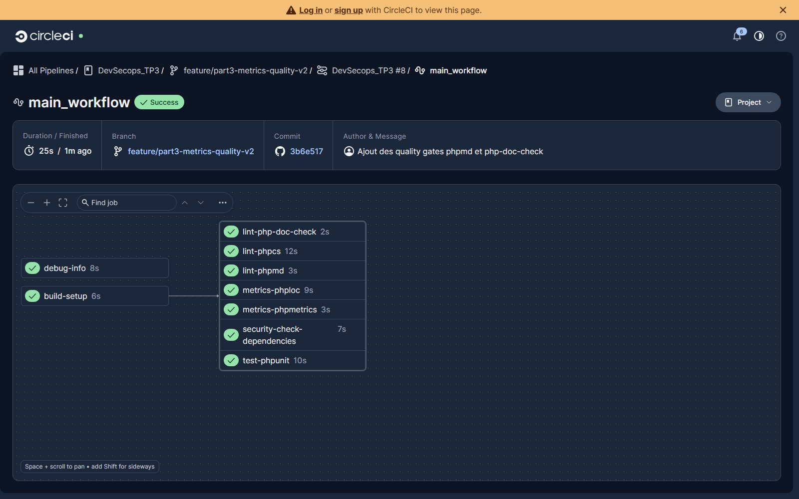
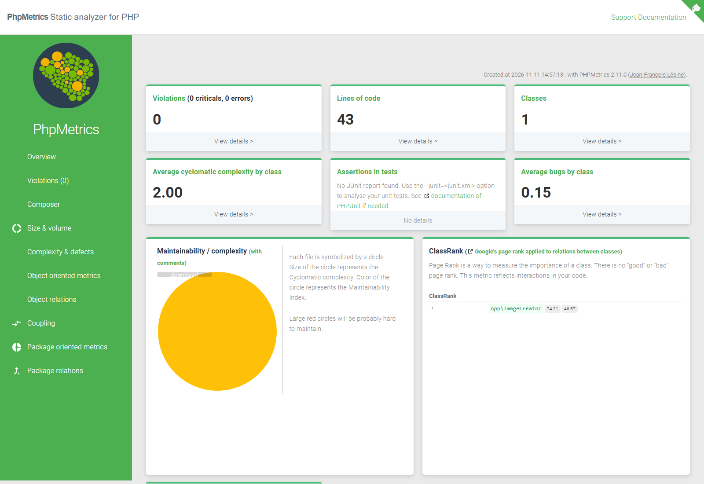
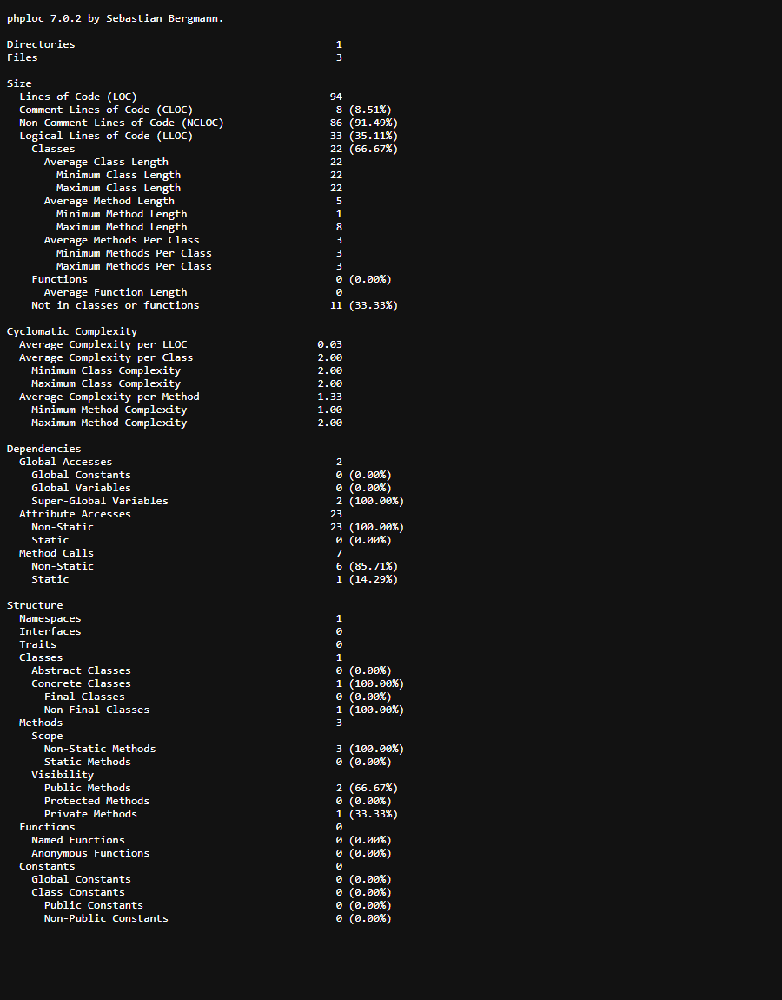
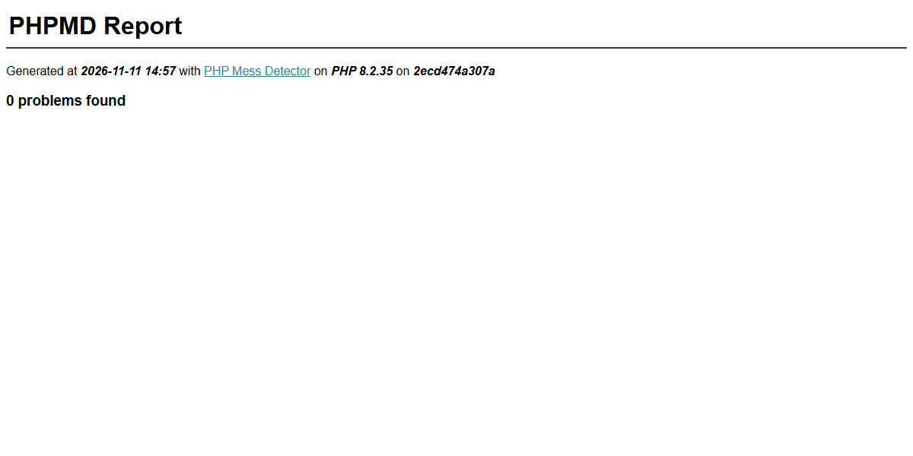
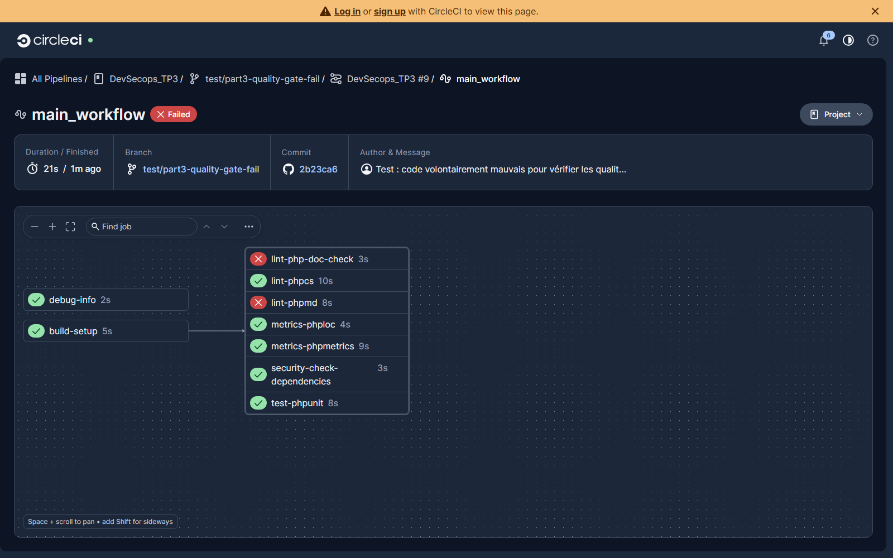
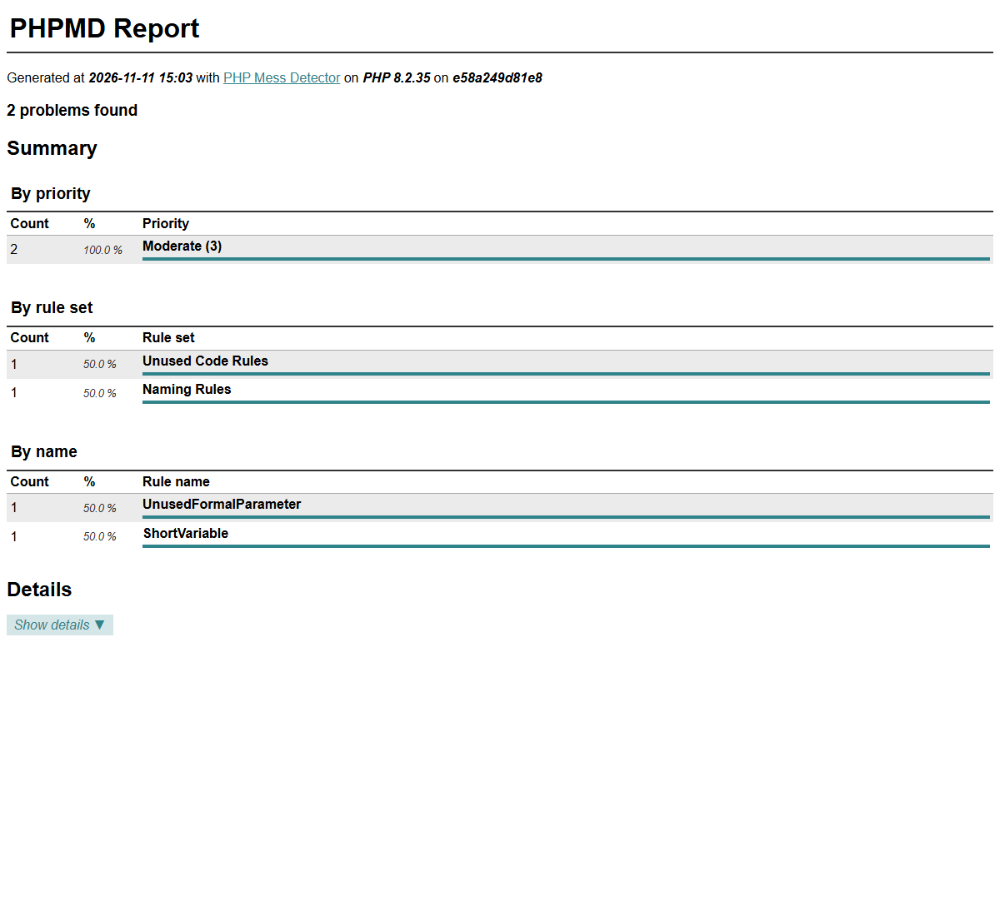
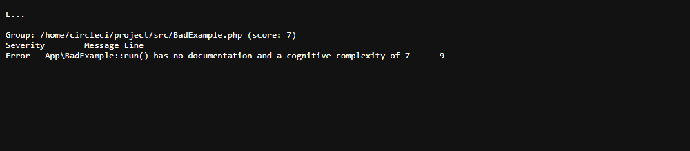

# Part 3 (points 1 and 2) – Code metrics and quality gates in the pipeline

Goal of this part (from the TP subject):

1. **3.1** Add two automatic code evaluation jobs to the pipeline: `phpmetrics/phpmetrics` and `phploc`.
2. **3.2** Integrate code quality tools in the pipeline: `phpmd` and `niels-de-blaauw/php-doc-check`.

Date: 10–11/11/2026 – Branch: `feature/part3-metrics-quality-v2`.
Every command was first run **locally**, then added to `.circleci/config.yml`.
We only **added** jobs: no existing job was changed.

---

## 1. Overview

| Job | Tool | Type | Blocks the pipeline? | Artifact |
|---|---|---|---|---|
| `metrics-phpmetrics` | PhpMetrics 2.11.0 | Metrics | No (informs) | HTML report `phpmetrics-report/` |
| `metrics-phploc` | phploc 7.0.2 (PHAR) | Metrics | No (informs) | `phploc-report/phploc.txt` |
| `lint-phpmd` | PHPMD 3.0.0 | Quality gate | **Yes** | `phpmd-report/phpmd.html` |
| `lint-php-doc-check` | php-doc-check 0.4.1 | Quality gate | **Yes** | `php-doc-check-report/php-doc-check.txt` |

The 4 jobs only need `build-setup` (`composer install` + `persist_to_workspace`). They get the code and `vendor/` with `attach_workspace` and run **in parallel** with `lint-phpcs`, `security-check-dependencies` and `test-phpunit`.



*Pipeline #8 on `feature/part3-metrics-quality-v2`: all jobs pass, including the 4 new ones.*

**Metrics vs quality gates.** A metric (size, complexity, coupling) has no "good" or "bad" value by itself: those jobs only **inform**, and keep their report as an artifact. A quality gate checks rules: if the code breaks a rule, the tool returns a non-zero exit code and **the job fails**.
This is on purpose the opposite of the existing `lint-phpcs` job, whose `if [ $result -eq 1 ] || [ $result -eq 2 ]; then exit 0` turns every error into a success: it never blocks bad code (see section 5).

---

## 2. How the tools are installed

Two options were possible:

- **A.** `composer require --dev <tool>` **inside each job** (what `lint-phpcs` does).
- **B.** Add the tools **once** in `require-dev`, commit `composer.json` and `composer.lock`. `build-setup` installs them, and the jobs get them from the workspace.

We chose **B**:

- **Reproducibility**: `composer.lock` pins the exact version, so the CI uses the version we tested locally. With A, every run takes the latest published version: a job can break without any change in our code.
- **Supply chain security**: with A, a compromised version published on Packagist would be installed and run by the CI right away. With B, nothing changes without an explicit decision (`composer update` + commit). "Latest version = safer" is a misconception: the good practice is to **pin versions and be alerted** (`security-check-dependencies` already scans `composer.lock`; Dependabot or Renovate could open update PRs tested by the CI).
- **Performance**: installed once in `build-setup`, with cache.
- The tools themselves are **scanned** by `security-check-dependencies`, since they are in the lock file.

```bash
composer config platform.php 8.2.0
composer require --dev phpmetrics/phpmetrics phpmd/phpmd niels-de-blaauw/php-doc-check
```

**Why `platform.php = 8.2.0`**: our machine has PHP 8.5, the CI image (`cimg/php:8.2`) and the Docker image (`php:8.2-apache`) have PHP 8.2. Without this setting, Composer picked versions for PHP 8.5 (for example Symfony 8.1, which needs PHP ≥ 8.4): it worked locally but would have broken in the CI. With it, Composer picks Symfony 7.4.

The Docker image is not affected: the `Dockerfile` runs `composer install --no-dev`.

`/reports` was added to `.gitignore`: reports are generated files, they are not versioned.

---

## 3. Point 3.1 – Metrics jobs

### 3.1 `metrics-phpmetrics`

```yaml
  metrics-phpmetrics:
    executor: php-executor
    steps:
      - *attach_workspace
      - run:
          name: Generate PhpMetrics report
          command: ./vendor/bin/phpmetrics --report-html=reports/phpmetrics src
      - store_artifacts:
          path: reports/phpmetrics
          destination: phpmetrics-report
```

Result on `src/`: 1 class, 3 methods, 43 lines of code, average cyclomatic complexity of 2, **0 violations**.



*The PhpMetrics HTML report, opened from the CircleCI artifacts.*

### 3.2 `metrics-phploc`

`phploc` is no longer maintained (archived repository) and its Composer package is not compatible with PHPUnit 10, used by the project. We use the **official PHAR** instead. Since we download an executable from the Internet, we apply the same principle as the lock file:

1. **Pinned version**: `phploc-7.0.2.phar`, not `phploc.phar` (which always points to the latest one).
2. **SHA-256 check before running it**: if the file on the server is changed or corrupted, `sha256sum -c` fails and the job stops **before** running it. The checksum was computed locally, and was the same on two independent downloads.

```yaml
  metrics-phploc:
    executor: php-executor
    environment:
      PHPLOC_VERSION: 7.0.2
      PHPLOC_SHA256: 3d59778ec86faf25fd00e3a329b2f9ad4a3c751ca91601ea7dab70f887b0bf46
    steps:
      - *attach_workspace
      - run:
          name: Download phploc (pinned version + checksum)
          command: |
            curl -sSfL -o phploc.phar "https://phar.phpunit.de/phploc-${PHPLOC_VERSION}.phar"
            echo "${PHPLOC_SHA256}  phploc.phar" | sha256sum -c -
      - run:
          name: Run phploc
          command: |
            set -o pipefail
            mkdir -p reports
            php phploc.phar src public | tee reports/phploc.txt
      - store_artifacts:
          path: reports/phploc.txt
          destination: phploc-report/phploc.txt
```

- Version and checksum are together in `environment:` so they are updated **together**.
- `curl -f` makes the command fail on an HTTP error (otherwise the error page would be saved as if it was the PHAR).
- `tee` sends the output to the CI log **and** to a file for the artifact. `set -o pipefail` is explained in section 4.2.



*phploc on `src` and `public`: 3 files, 94 lines, 1 class, 3 methods, average method complexity 1.33.*

---

## 4. Point 3.2 – Quality gates

### 4.1 `lint-phpmd`

First run with the default rulesets: **3 violations** in `src/ImageCreator.php`, exit code 2:

- `ShortVariable`: `$im` (less than 3 characters);
- `Superglobals` ×2: access to `$_ENV`.

For each violation we had 3 options: fix the code, allow **this precise rule** with a written reason, or disable the tool (excluded: we would lose the gate). We did not change the code of the application (written by another member of the group). The rules are in **`phpmd.xml`** at the root (like `phpcs.xml`), each exception has a comment with its reason:

- `Superglobals` is excluded: `vlucas/phpdotenv` puts the `.env` variables in `$_ENV`, that is how the library is meant to be used.
- `ShortVariable` is kept, with an exception **only for `$im`** (the usual name of a GD image in the PHP documentation). Any other short variable is still reported.

```yaml
  lint-phpmd:
    executor: php-executor
    steps:
      - *attach_workspace
      - run:
          name: Run PHPMD (rules in phpmd.xml)
          command: |
            mkdir -p reports
            ./vendor/bin/phpmd analyze src public \
              --ruleset phpmd.xml \
              --format text \
              --reportfile-html reports/phpmd.html \
              --no-progress
      - store_artifacts:
          path: reports/phpmd.html
          destination: phpmd-report/phpmd.html
```

- No `if ... exit 0`: exit code 2 makes the job fail.
- `--format text` prints the violations in the CI log, `--reportfile-html` writes the HTML artifact, in one run.
- No `when: always` on `store_artifacts`: this step **always** runs, even after a failed step, and the `when` key is not supported on it. The red pipeline below proves it: the report of the failed job is available.



*With `phpmd.xml`: 0 problems on the project code.*

### 4.2 `lint-php-doc-check`

The tool reports **complex functions without a doc comment** (`/** */`). It measures cognitive complexity: ≥ 4 without doc = warning, ≥ 6 without doc = **error** (exit code 1). On the project: `...` (3 files analysed, nothing to report).

```yaml
  lint-php-doc-check:
    executor: php-executor
    steps:
      - *attach_workspace
      - run:
          name: Run php-doc-check (complex code must be documented)
          command: |
            set -o pipefail
            mkdir -p reports
            ./vendor/bin/php-doc-check src public | tee reports/php-doc-check.txt
      - store_artifacts:
          path: reports/php-doc-check.txt
          destination: php-doc-check-report/php-doc-check.txt
```

**Trap: the exit code lost in a pipe.** In a pipe, bash keeps the exit code of the **last** command: `tee`, which always succeeds. Without care, the gate would never block. CircleCI normally uses `/bin/bash -eo pipefail`, but the executors of the project set `shell: /bin/bash` **without options**, which removes this default. So we put `set -o pipefail` on the first line: the pipe fails if **any** command fails. The same fix is in the *Run phploc* step: without it, a crash of phploc would give a green job without report.

---

## 5. Proof that the gates block bad code

A gate that never fails proves nothing: we had to check that we did not just "silence" the tools to get a green job. We pushed a throwaway branch, `test/part3-quality-gate-fail` (never merged), with an intentionally bad file `src/BadExample.php`: a method `run($a, $unused)` with an unused parameter, a short variable name and 4 nested `if` without documentation.



*Pipeline #9: `lint-phpmd` and `lint-php-doc-check` fail, so the workflow fails. The metrics jobs stay green (they do not block), and `test-phpunit` is green (the code still works).*



*PHPMD finds `UnusedFormalParameter` (`$unused`) and `ShortVariable` (`$a`): the `$im` exception is precise, `$a` is still refused. The report is available even though the job failed.*



*php-doc-check: `run()` has no documentation and a cognitive complexity of 7 → error, exit code 1, which goes through `tee` thanks to `pipefail`.*

Note: on the same pipeline, **`lint-phpcs` is green** even with this bad code. This confirms that the existing job never blocks anything (its `exit 0` hides errors). To be discussed in part 5.

---

## 6. Tests done

| Test | Where | Result |
|---|---|---|
| `composer install` + PHPUnit (existing test) | Local + CI | OK (1 test, 1 assertion): nothing broken |
| PhpMetrics | Local + CI | 0 violation, HTML report as artifact |
| phploc checksum + run | Local + CI | `sha256sum: OK`, report as artifact |
| PHPMD with `phpmd.xml` | Local + CI | 0 problem, exit code 0 |
| php-doc-check | Local + CI | `...`, exit code 0 |
| **Negative** PHPMD and php-doc-check | Local + CI (`test/part3-quality-gate-fail`) | Exit codes 2 and 1, jobs **red** |
| `config.yml` | parsed with `symfony/yaml` + accepted by CircleCI | 4 jobs defined and listed in `main_workflow` |
| Docker image build (`container_workflow`) | CI | Green, dev tools not in the image (`--no-dev`) |

---

## 7. Ideas for part 5

- `lint-phpcs` never blocks (`exit 0` on errors): make it a real gate.
- `composer audit` reports 2 vulnerabilities that were already there before our changes: `nesbot/carbon` CVE-2025-22145 (medium, fixed in 2.72.6) and `phpunit/phpunit` CVE-2026-24765 (high, fixed in 10.5.62).
- Dependabot or Renovate to propose dependency updates as PRs tested by the CI.
- `security-check-dependencies` downloads its binary without checksum: apply the same check as for phploc.
